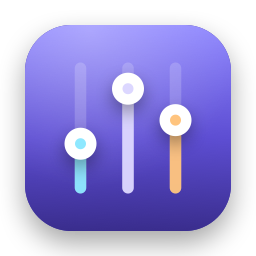

<p align="center"></p>

<h1 align="center">AppVolume</h1>

<p align="center">Per-app volume control for the macOS menu bar. Native Swift/SwiftUI, no kernel extension, no virtual audio driver.</p>

---

## Features

- Click the menu bar icon to see every app that is currently playing audio: icon, name, volume slider (0–100 %) and mute button.
- The list updates automatically when apps start or stop playing.
- Helper processes (e.g. “Google Chrome Helper”, Safari's WebKit processes) are grouped under their main app.
- Switching the output device (e.g. to headphones) keeps working without a restart.
- Volumes are remembered per app (bundle ID) and applied again on the next launch.
- Optional “Launch at login”.
- No Dock icon.

## Requirements

- macOS 14.2 or later (uses Core Audio process taps)
- Xcode 16 or later to build

## Download

Grab `AppVolume-x.y.zip` from the [latest release](https://github.com/NOX2912/AppVolume/releases/latest), unzip it
and move `AppVolume.app` to `/Applications`.

The download is not notarized by Apple, so macOS blocks it on first launch. To allow it, either run

```bash
xattr -dr com.apple.quarantine /Applications/AppVolume.app
```

or try to open the app once, then click **Open Anyway** in *System Settings → Privacy & Security*.

## Build and run

**In Xcode:** open `AppVolume.xcodeproj`, choose the “AppVolume” scheme and press ⌘R.

**From the terminal:**

```bash
xcodebuild -project AppVolume.xcodeproj -scheme AppVolume -configuration Release -derivedDataPath build build
cp -R build/Build/Products/Release/AppVolume.app /Applications/
open /Applications/AppVolume.app
```

On first launch macOS asks for permission to **record system audio**. AppVolume needs it to intercept app audio.
You can change it later in *System Settings → Privacy & Security → Screen & System Audio Recording → System Audio
Recording Only*.

The project is signed “to run locally” (ad hoc). After rebuilding, macOS may ask for the permission again.

## How it works

For every app whose volume is below 100 % (or that is muted), AppVolume creates a Core Audio **process tap**
(`CATapDescription`, original audio muted) and a private **aggregate device** with the tap as input and the current
output device as output. A real-time IOProc copies the tapped audio to the output and applies the gain.

| File | Purpose |
|---|---|
| `AudioController.swift` | Watches the Core Audio process list and `IsRunningOutput`, groups processes per app, manages taps, follows the default output device. |
| `ProcessTap.swift` | One tap plus aggregate device per app; the render callback (no allocations, no locks). |
| `AppResolver.swift` | Maps helper processes to their main app: responsible process → outermost `.app` bundle in the executable path → parent processes. |
| `VolumeStore.swift` | Volume and mute state per bundle ID in `UserDefaults`. |
| `ContentView.swift` | The popover UI. |
| `AppVolumeApp.swift` | `MenuBarExtra` and “Launch at login” via `SMAppService`. |
| `Scripts/make-icon.swift` | Draws the app icon in all sizes (`swift Scripts/make-icon.swift`). |

Notes:

- At 100 % and not muted, no tap is created. The app's audio is left completely untouched.
- A tap stays alive as long as the app has audio processes, so resuming playback never blasts at full volume for a moment.
- The slider uses a squared curve (50 % on the slider sounds roughly half as loud).
- No sandbox. Uses two private but long-standing system functions: `responsibility_get_pid_responsible_for_pid`
  (helper → app mapping) and `TCCAccessPreflight`/`TCCAccessRequest` (permission check). Both are loaded dynamically
  and the app works without them.

## Deutsch (Kurzfassung)

Menüleisten-App, mit der sich die Lautstärke jeder App einzeln regeln lässt. Bauen: `AppVolume.xcodeproj` in Xcode
öffnen und ⌘R drücken, oder die Befehle oben im Terminal ausführen. Beim ersten Start die Berechtigung „Systemaudio
aufnehmen“ erlauben. Die Oberfläche ist derzeit auf Deutsch.

## License

[MIT](LICENSE)
