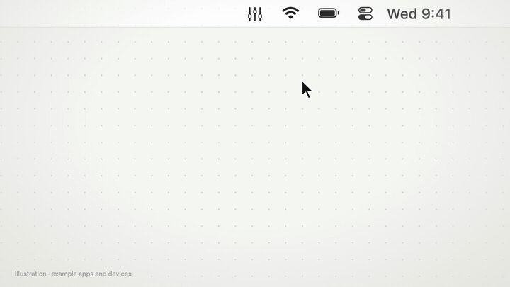

<p align="center"></p>

<h1 align="center">AppVolume</h1>

<p align="center">Per-app volume control in the macOS menu bar.</p>

<p align="center"></p>

- Volume slider and mute button for every app that is playing audio
- Helper processes (Chrome, Safari, Electron apps) are grouped under their app
- Keeps working when you switch output devices
- Remembers volumes per app, optional launch at login
- English and German

Requires macOS 14.2 or later.

## Install

Download the zip from the [latest release](https://github.com/NOX2912/AppVolume/releases/latest), unzip it and move
`AppVolume.app` to `/Applications`. The app is not notarized, so allow it once:

```bash
xattr -dr com.apple.quarantine /Applications/AppVolume.app
```

On first launch, allow **System Audio Recording**. AppVolume needs it to change app volumes.

## Build

```bash
xcodebuild -project AppVolume.xcodeproj -scheme AppVolume -configuration Release -derivedDataPath build build
```

Or open `AppVolume.xcodeproj` in Xcode and press ⌘R.

## License

[MIT](LICENSE)
